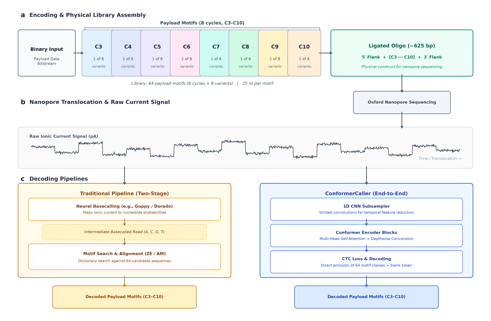
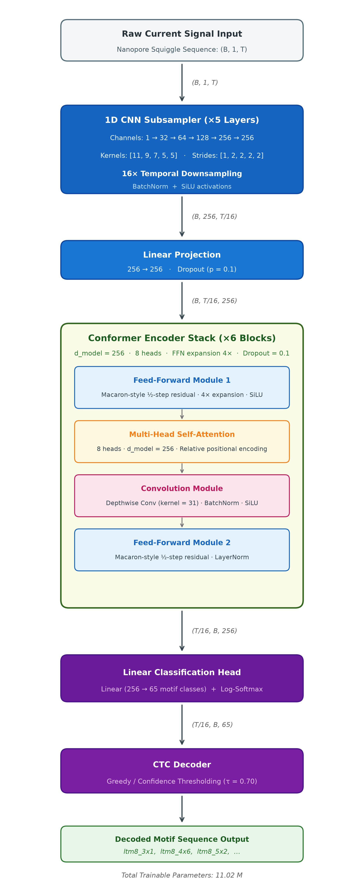

# ConformerCaller: Direct Motif Calling from Nanopore Signals for DNA Data Storage

[](https://pytorch.org/)
[](https://www.python.org/)
[](LICENSE)

Official implementation and pretrained models for **"ConformerCaller: Direct Motif Calling from Nanopore Signals for DNA Data Storage"** (Dev Thakkar and Long Tran-Thanh, Department of Computer Science, University of Warwick).

---

## Overview

Motif-based combinatorial DNA synthesis enables high-density, low-cost digital data archiving by assembling predefined short sequences (motifs) into structured payload strands. However, decoding digital information from raw Oxford Nanopore Technologies (ONT) ionic current squiggles has traditionally relied on a decoupled, two-stage pipeline:

1. **General-purpose basecalling** (e.g., Guppy, Dorado) mapping ionic current to nucleotide strings ($A, C, G, T$).
2. **Heuristic motif alignment** (e.g., Zero-Error Search, Adaptive Margin Search) aligning basecalled strings against motif dictionaries.

This decoupled paradigm suffers from **compound error propagation**: insertion, deletion, and substitution errors during basecalling degrade subsequent sequence alignment, especially on low-quality reads.

**ConformerCaller** replaces this pipeline with an **end-to-end neural architecture** that directly translates raw, continuous nanopore current traces into discrete payload motif sequences using Connectionist Temporal Classification (CTC) decoding.

<p align="center">
  
</p>

---

## Key Highlights & Results

- **92.1% Motif Detection Rate**: Directly decodes raw electrical signals on a held-out test split of 66,843 empirical reads.
- **90.4% Mean Per-Cycle Accuracy**: Consistently high classification accuracy across all eight payload cycles $(C_3-C_{10})$.
- **Zero Cross-Cycle Confusion**: 100% of all 31,033 observed misclassifications occurred strictly within the true cycle index. The model naturally learns macromolecular physical ordering without explicit positional tokens.
- **$2.8\times$ Reduction in Sequencing Coverage**: Lowers the read coverage required to reach 95% payload information recovery from 14 reads down to 5 reads.
- **Real-Time Portable Inference**: Achieves 129.7 reads/sec with a mean latency of 7.7 ms per read on standard consumer silicon.
- **Trained on Verified Physical Labels**: Supervised against verified physical synthesis catalogs (`HELIX01-04_master_db.txt`), bypassing the error floor of heuristic aligners.

### Benchmark Comparison

| Method | Decoding Paradigm | Training Supervision | Detection Rate (%) | 95% Recovery (Reads) |
|---|---|---|:---:|:---:|
| **ZE Search** | Two-step (Basecalled) | Heuristic dictionary | ~65% | ~50 (Empirical) |
| **AM Search** | Two-step (Basecalled) | Heuristic aligner | ~85% | ~22 (Empirical) |
| **CNN + BiGRU** | End-to-end | AM Search labels | 91.1%* | 14 (Empirical) |
| **ConformerCaller (Greedy)** | **End-to-end** | **Synthesis ground-truth** | **92.1%** | **~5 (Analytical)** |
| **ConformerCaller ($\tau \ge 0.70$)** | **End-to-end** | **Synthesis ground-truth** | **82.3%** | **~5 (Analytical)** |

*\*Evaluated against AM Search labels. ConformerCaller is evaluated against verified physical ground truth.*

---

## Model Architecture

ConformerCaller comprises three core functional stages totaling **11.02M parameters**:

1. **Convolutional Subsampler (1D CNN)**: 5 layers with channel dimensions $1 \to 32 \to 64 \to 128 \to 256 \to 256$, kernel sizes $[11, 9, 7, 5, 5]$, strides $[1, 2, 2, 2, 2]$, Batch Normalization, and SiLU activations. Applies a $16\times$ temporal downsampling factor.
2. **Conformer Encoder Stack**: 6 Conformer blocks ($d_{\text{model}} = 256$, 8 attention heads, depthwise convolution kernel 31, feed-forward expansion factor 4). Employs relative positional encoding to track long-range sequential context across variable-speed translocations.
3. **Linear Classification Head & CTC Decoder**: Maps encoder states to 65 classes (64 payload motifs + 1 CTC blank token $\epsilon$). Decoded via greedy CTC or confidence-filtered greedy decoding ($\tau \ge 0.70$).

<p align="center">
  
</p>

---

## Repository Structure

```
ConformerCaller/
├── config.py                  # Global configuration (paths, constants, parameters)
├── train.py                   # Main CLI entry point for model training
├── requirements.txt           # Python dependencies
├── LICENSE                    # Custom Non-Commercial Research License
├── README.md                  # Project documentation
│
├── checkpoints/
│   └── conformer/
│       └── best_model.pt      # Pretrained optimal checkpoint (Epoch 48, val_loss=0.7971)
│
├── splits/
│   ├── train_read_ids.txt.gz  # Exact paper training split (501,330 read IDs)
│   ├── val_read_ids.txt.gz    # Exact paper validation split (100,265 read IDs)
│   └── test_read_ids.txt.gz   # Exact paper test split (66,843 read IDs)
│
├── scripts/
│   └── prepare_data.py        # Downloads, checksum-verifies, and unpacks Zenodo + OSF data
│
├── notebooks/
│   ├── colab_training.ipynb   # Distributed / Google Colab training notebook
│   ├── full_eval.py           # Full test set evaluation script (66,843 reads)
│   ├── paper_analysis.py      # Detailed metrics, confusion analysis, and recovery curves
│   ├── generate_architecture_diagram.py  # Generates Figure 2 (architecture)
│   └── generate_encoding_schematic.py   # Generates Figure 1 (encoding/decoding)
│
├── results/
│   └── paper/
│       ├── full_test_eval.json           # Complete test set metrics
│       ├── top_confusions.json           # Detailed pairwise confusion frequencies
│       ├── architecture_diagram.png      # High-resolution architecture diagram
│       ├── encoding_schematic.png        # Pipeline schematic diagram
│       ├── per_cycle_accuracy_66k.png    # Per-cycle accuracy chart
│       ├── information_recovery_66k.png  # Information recovery vs. read depth
│       ├── confusion_analysis.png        # Within-cycle error breakdown
│       ├── detection_comparison.png      # Method comparison bar chart
│       └── training_curves.png           # 55-epoch training and validation loss curves
│
└── src/
    ├── data/
    │   ├── motif_library.py              # Motif catalog mappings & cycle allocations
    │   ├── fast5_reader.py               # Raw FAST5 signal extraction & MAD normalisation
    │   ├── label_builder.py              # Ground-truth label construction from master DB
    │   ├── dataset.py                    # PyTorch Dataset and DataLoader implementations
    │   ├── build_training_set.py         # One-time dataset index partitioning
    │   └── extract_signals_sharded.py    # Sharded signal extraction utility
    ├── model/
    │   └── motifcaller.py                # Conformer, CNN-BiGRU, and Causal CNN architectures
    ├── training/
    │   ├── trainer.py                    # PyTorch CTC training engine & early stopping
    │   ├── ctc_decoder.py                # Greedy & confidence-thresholded CTC decoders
    │   └── metrics.py                    # Levenshtein distance, exact match, & cycle accuracy
    ├── evaluation/
    │   └── evaluate.py                   # Architecture evaluation and comparison suite
    └── inference/
        └── predict.py                    # End-to-end inference on raw FAST5 files
```

---

## Installation

### 1. Clone the Repository
```bash
git clone https://github.com/devthakkar/ConformerCaller.git
cd ConformerCaller
```

### 2. Create Virtual Environment
```bash
python3 -m venv venv
source venv/bin/activate
```

### 3. Install Dependencies
```bash
pip install --upgrade pip
pip install -r requirements.txt
```

> **Note on ONT FAST5 files:** ONT sequencing data uses VBZ compression. The `vbz-h5py-plugin` package included in `requirements.txt` is required to read multi-read FAST5 files.

---

## Data Preparation (Public Zenodo & OSF Dataset)

All data required to run inference, reproduce test evaluation, or retrain ConformerCaller are publicly archived across two Zenodo records and an OSF repository.

Use `scripts/prepare_data.py` to automatically fetch, MD5-verify, and unpack everything into a single data root directory:

```bash
# Optional: 7-Zip binary for fast archive extraction (recommended)
# macOS:  brew install sevenzip
# Ubuntu: sudo apt install p7zip-full
# Or install pure-Python fallback: pip install py7zr

# Quick-start subset (reference tables + labels + smallest 9-file FAST5 archive 1122-1130)
python scripts/prepare_data.py --dest /path/to/data_root --fast5 1122-1130

# Full dataset (all 18 FAST5 archives: 1,131 .fast5 files; ~55 GB download, ~77 GB extracted)
python scripts/prepare_data.py --dest /path/to/data_root
```

If you already downloaded the `.7z`, `.txt`, and `.csv` files manually, pass `--archives-dir` to checksum-verify and extract them without re-downloading:

```bash
python scripts/prepare_data.py \
    --dest /path/to/data_root \
    --archives-dir /path/to/downloads
```

Then point `ConformerCaller` to your prepared directory (defaults to `./data` if unset):

```bash
export CONFORMERCALLER_DATA_ROOT=/path/to/data_root
```

---

## Quickstart: Inference on Raw Reads

Run inference on raw FAST5 files using the provided pretrained model:

```bash
python src/inference/predict.py \
    --checkpoint checkpoints/conformer/best_model.pt \
    --fast5-dir "$CONFORMERCALLER_DATA_ROOT/FAST5" \
    --library "$CONFORMERCALLER_DATA_ROOT/Reference/completed_library.csv" \
    --output results/predictions.csv \
    --threshold 0.70
```

> **Note on `--library`:** If `CONFORMERCALLER_DATA_ROOT` is set in your environment, `--library` automatically resolves to `$CONFORMERCALLER_DATA_ROOT/Reference/completed_library.csv`. Omit `--threshold` for standard greedy CTC decoding, or pass `--max-reads 50` for a quick test run.

The output CSV contains per-read predicted payload motif sequences:
```csv
read_id,predicted_motifs,n_motifs,confidence
0001a79f-683a-442f-8703-a4176378a3c5,"ltm8_3x1|ltm8_4x6|ltm8_5x2|ltm8_6x4|ltm8_7x1|ltm8_8x3|ltm8_9x8|ltm8_10x2",8,0.942
```

---

## Reproducing Paper Results & Figures

### 1. Full Test Set Evaluation (66,843 Reads)
With `CONFORMERCALLER_DATA_ROOT` prepared and exported, reproduce the dataset splits, signal shards, and test evaluation in three commands:

```bash
# Step 1: Parse HELIX01-04_master_db.txt, index FAST5 files, and apply the paper splits (splits/)
python src/data/build_training_set.py

# Step 2: Extract test-split raw signals into memory-safe NPZ shards (~7 shards on full dataset)
python src/data/extract_signals_sharded.py \
    --index-dir "$CONFORMERCALLER_DATA_ROOT/processed/dataset_index" \
    --splits test

# Step 3: Evaluate checkpoints/conformer/best_model.pt on the test shards
PYTHONPATH=. python notebooks/full_eval.py
```

`notebooks/full_eval.py` writes its reproduced metrics to `results/full_test_eval_reproduced.json` so the original reference file `results/paper/full_test_eval.json` is never overwritten. If you prepared a subset with `--fast5 1122-1130`, the exact same commands evaluate the corresponding subset of paper test reads (and `--max-shards 1` or `--max-reads 500` can be used for a fast sanity check).

### 2. Regenerate Paper Figures
To regenerate the publication-ready schematics and analysis plots:
```bash
# Architecture diagram (Figure 2)
PYTHONPATH=. python notebooks/generate_architecture_diagram.py

# Encoding & decoding schematic (Figure 1)
PYTHONPATH=. python notebooks/generate_encoding_schematic.py

# Confusion analysis and information recovery curves
PYTHONPATH=. python notebooks/paper_analysis.py
```

---

## Model Training

### Local Training
After building the dataset index (Step 1 above), train ConformerCaller locally from scratch (use `--smoke-test` for a quick 5-batch pipeline verification):
```bash
python train.py \
    --arch conformer \
    --epochs 100 \
    --batch-size 16 \
    --lr 3e-4 \
    --checkpoint-dir checkpoints/conformer
```

### Distributed / Cloud Training (Google Colab A100)
For large-scale training across all 501,330 training reads:
1. Extract all splits (`train`, `val`, `test`) with `python src/data/extract_signals_sharded.py --index-dir "$CONFORMERCALLER_DATA_ROOT/processed/dataset_index"`.
2. Open [`notebooks/colab_training.ipynb`](notebooks/colab_training.ipynb) in Google Colab and select an **A100 GPU (High RAM)** runtime.
3. Execute the cells to stream sharded signals (`signal_shards/` and generated `shard_split_ids.json`) with mixed-precision (FP16) CTC training.

---

## Data Availability

The raw FAST5 sequencing data and per-read motif label assignments used in this work are publicly archived on Zenodo under the Helixworks Technologies dataset series **"Sequencing Runs from Motif-based DNA Data Storage Systems"**, and the motif catalog is archived on OSF:

| Source | Identifier / Link | Contents |
|---|---|---|
| **Zenodo — HELIX01-04\_Part\_01** | [10.5281/zenodo.15839390](https://doi.org/10.5281/zenodo.15839390) ([record](https://zenodo.org/records/15839390)) | `HELIX01-04_master_db.txt`, `HELIX01-04-encoded.csv`, and multi-read FAST5 archives (Part 1) |
| **Zenodo — HELIX01-04\_Part\_02** | [10.5281/zenodo.15848607](https://doi.org/10.5281/zenodo.15848607) ([record](https://zenodo.org/records/15848607)) | Multi-read FAST5 archives (Part 2) |
| **OSF — Motif-based DNA Data Storage System** | [https://osf.io/pcdtj/](https://osf.io/pcdtj/) | `completed_library.csv` and `motif_design_sequences.csv` (under `DNA Construct Sequences/`) |

**Files used:** All 1,131 multi-read FAST5 files across both Zenodo records, paired with `HELIX01-04_master_db.txt` (Zenodo Part 01) and `completed_library.csv` (OSF), yielding 696,435 quality-filtered reads ($\ge 4$ payload cycles) and 668,438 reads in the final dataset splits (501,330 training / 100,265 validation / 66,843 test; see `src/data/build_training_set.py`). Both Zenodo records and `completed_library.csv` from OSF are required to reproduce the full dataset.

Code, exact paper split manifests (`splits/{train,val,test}_read_ids.txt.gz`), trained model weights (`checkpoints/conformer/best_model.pt`), and reference evaluation outputs (`results/paper/`) are included in this repository.


---

## License

This project uses a custom license. See the [LICENSE](LICENSE) file for details.


